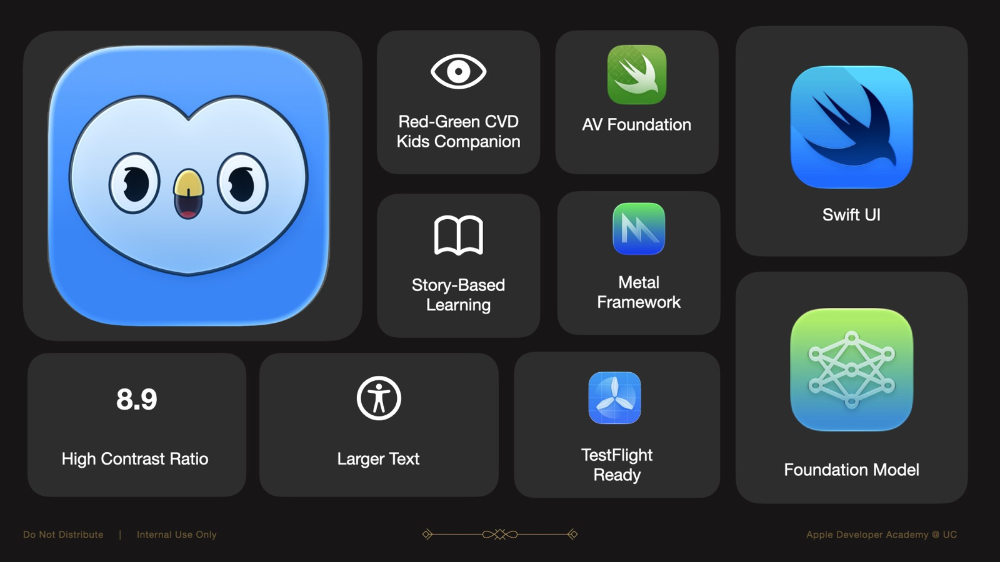
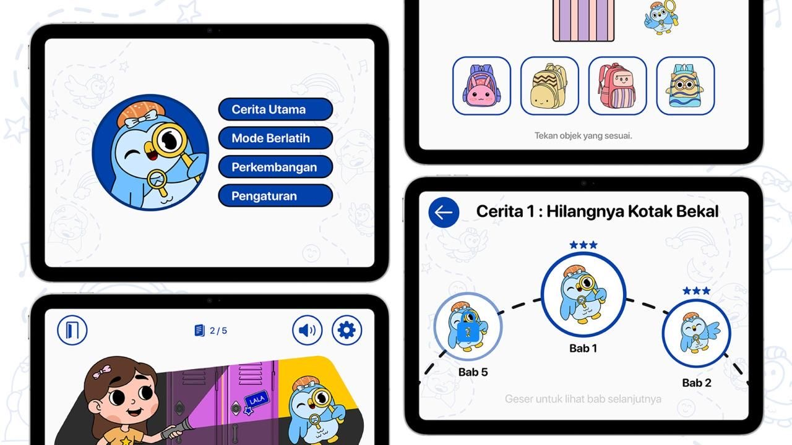

# OwlLala

**A story-based iPad learning app for children with colour vision deficiency.** OwlLala teaches children aged 5–12 to recognise objects through shape, pattern, contrast, labels and context, instead of colour.



## The problem

Children with partial red-green colour vision deficiency are still expected to learn through colour cues. We ran field research and interviewed users, then designed a learning flow that doesn't depend on colour at all.

## What's inside

- **Main Story:** one illustrated, narrated story told across five chapters. Each chapter ends in a mini-game.
- **Immediate feedback:** a shake and red outline for a wrong answer, a hint after the second miss, and confetti and applause for the right one.
- **Stars:** 3 for no mistakes, 2 for one, and 1 otherwise.
- **Training Mode:** replays all five mini-games once the story is complete.
- **Statistics for parents:** total stars, chapter completion, and a competency score for each chapter.
- **Accessibility:** high-contrast design (8.9:1), Dynamic Type, and brightness and simulation settings.



## Architecture

MVVM with SwiftUI and `ObservableObject`. Static story content is kept separate from persisted progress.

```
OwlLala/
├── Models/        Story, Chapter, UserStats, GameStats, Settings
├── ViewModels/    MainMenu, StorySelection, ChapterSelection, ChapterGameplay, Statistics, Settings
├── Services/      StorageService (Codable + UserDefaults), AudioService
├── Components/    Competency graph, feedback, story navigation, buttons, theme
└── Resources/     Narration and sound effects
```

## Requirements

- Xcode 26 or later
- iPadOS 26.5 or later (iPad only)

## Run it

1. Clone the repo.
2. Open `OwlLala.xcodeproj`.
3. Select the **OwlLala** scheme.
4. Run on an iPad or iPad simulator.

## Team

Built by a five-person team at the Apple Developer Academy @ UC, Jun – Aug 2026. [Heidy Mudita Sutedjo](https://github.com/estpoz) was project manager and an iOS developer, and built the statistics feature.

## Tech

Swift · SwiftUI · Dynamic Type · AVFoundation · Xcode Cloud · GitHub Projects
